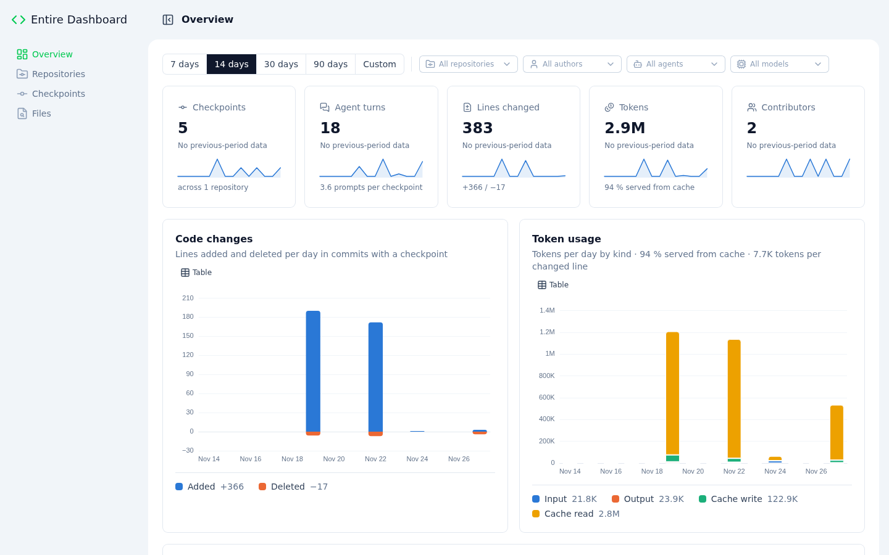
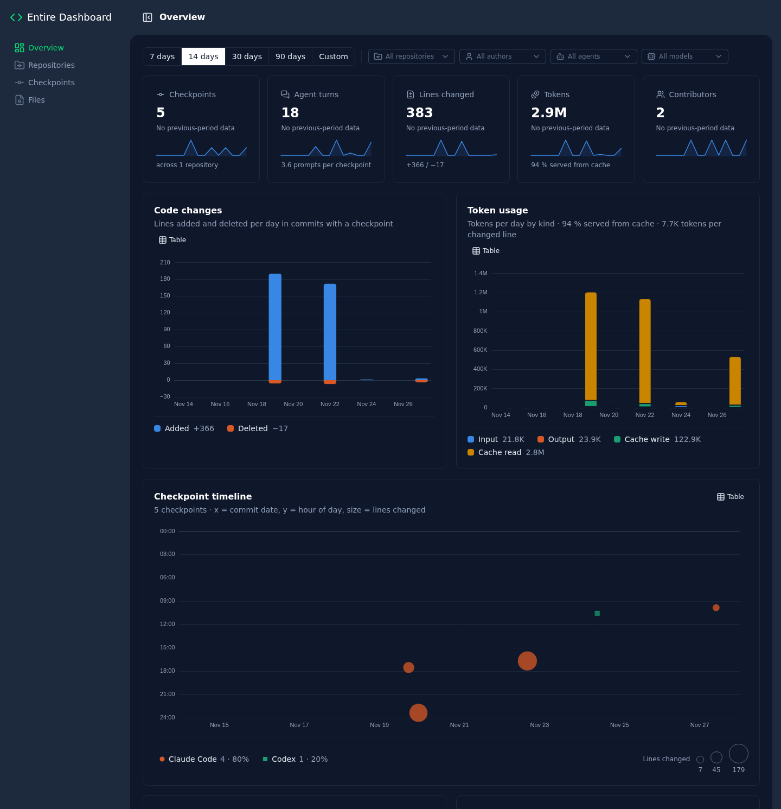
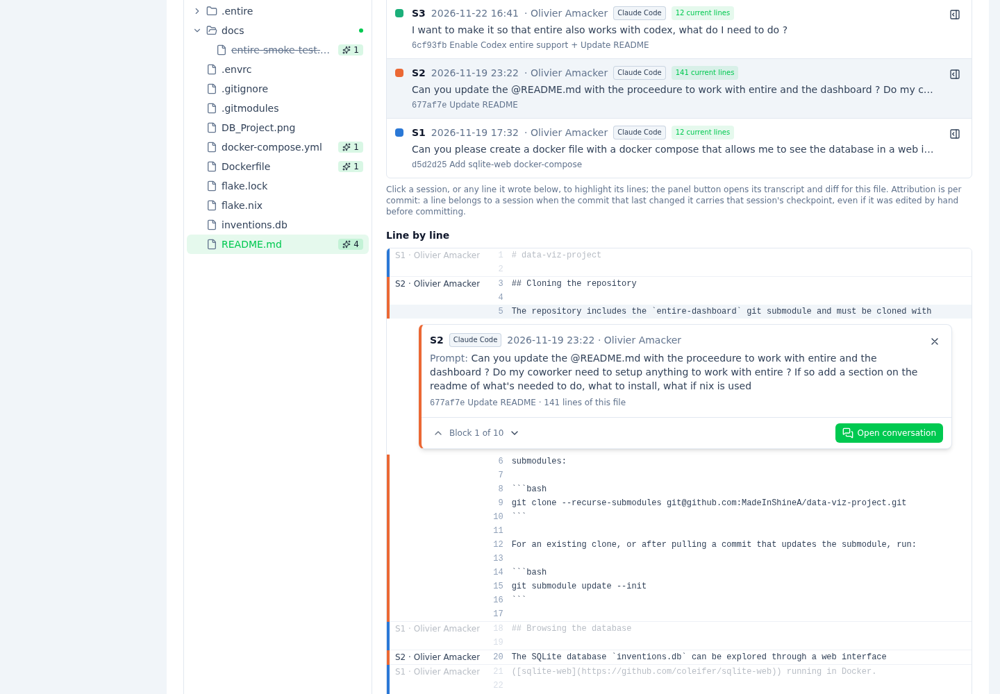
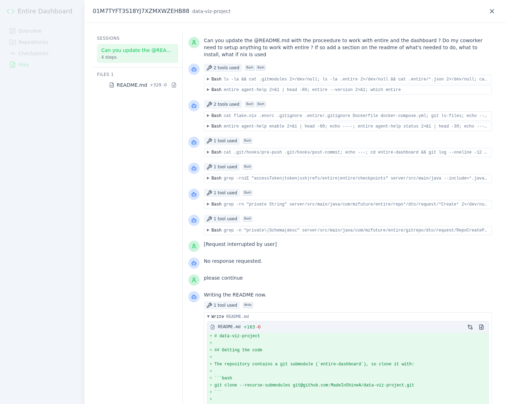

<h1 align="center">Entire Dashboard</h1>

<p align="center">
  <strong>Every commit tells a story. See how AI helped write it.</strong>
</p>

<p align="center">
  
  
  
  
  
</p>

<p align="center">
  
</p>

Entire Dashboard is a self-hosted analytics platform for the AI coding sessions recorded by
[Entire CLI](https://github.com/entireio/cli). Entire links every commit to the agent sessions behind it
(prompts, transcripts, tool calls, token usage). The dashboard syncs that data from your Git hosting and turns it
into charts, searchable history and line-by-line attribution.

> [!NOTE]
> **This project continues [sunmh207/entire-dashboard](https://github.com/sunmh207/entire-dashboard)**, whose
> development stopped in June 2026. This fork picks up where it left off: it supports the storage format of current
> Entire CLI releases, which the original no longer reads, and adds the features listed below.

## Contents

- [What this fork adds](#what-this-fork-adds)
- [Features carried over](#features-carried-over)
- [Requirements](#requirements)
- [Quick start with Docker](#quick-start-with-docker)
- [Usage](#usage)
- [Upgrading](#upgrading)
- [Local development](#local-development)
- [Architecture](#architecture)
- [Credits and license](#credits-and-license)

## What this fork adds

### Analytics overview

<p align="center">
  
</p>

The overview was rebuilt around the data Entire CLI 0.13.2+ actually records.

- **Stat tiles** for checkpoints, agent turns, lines changed, tokens and contributors, each with a sparkline and its
  change against the previous period of the same length.
- **Code changes** per day: lines added above the axis, lines deleted below.
- **Token usage** per day split into input, output, prompt-cache writes and prompt-cache reads, with the share served
  from the cache and the tokens spent per changed line.
- **Checkpoint timeline**: every checkpoint by date and hour of day, sized by lines changed, colored and shaped by
  agent. Click a point to open the checkpoint.
- **Breakdown** by repository, author, agent or model, ranked by checkpoints, lines, tokens or turns.
- **Activity heatmap** of checkpoints by weekday and hour, in your timezone.
- **Cross-filtering**: click a bar or a legend entry to filter the whole page. The period and filters are stored in
  the URL, so a view can be bookmarked or shared.
- **Accessible by design**: every chart has a table view, agents are told apart by shape as well as color, and the
  palette is validated for color-vision deficiencies in both light and dark mode.

### Line-by-line file attribution

<p align="center">
  
</p>

A new **Files** page shows the repository tree for any branch. Files touched by AI sessions are marked with the
number of sessions involved.

- Pick a file to list the sessions that touched it, and see for each current line which session wrote it
  (attributed through the commit that last changed the line, using Git blame).
- **Click any line** to highlight everything that session wrote and open a card with its prompt, commit, number of
  lines in the file, and arrows to jump between its blocks.
- From the card, **Open conversation** shows the session's full transcript. The session list opens the session's
  diff of that file.

### Readable session transcripts

<p align="center">
  
</p>

- Tool calls are shown as cards with their command or file and their output; failed calls are flagged.
- `Edit`, `MultiEdit`, `Write` and Codex `apply_patch` calls render as inline diffs, with links to the file's
  session diff and to the Files page.
- Codex transcripts are cleaned up (duplicate events and injected context removed) and rendered like Claude Code's.

### Support for current Entire CLI releases

- Reads the per-checkpoint refs storage (`refs/entire/checkpoints/<shard>/<id>`) and 26-character ULID checkpoint
  ids introduced in Entire CLI 0.13, while still reading the legacy `entire/checkpoints/v1` branch.
- Records the 0.13.2 session metadata: prompt-cache tokens, model and number of turns.

### Reliability and security

- A failed sync is reported as an error instead of a silent success.
- Validating an access token also checks that it can read the repository.
- Access tokens are masked in error messages and logs.
- Every page requires a login.
- The Checkpoints page opens on the full history, starting at the first checkpoint.

### Developer experience

- A Nix flake provides the whole toolchain (see [Local development](#local-development)).
- Docker Compose works with Podman, and multi-architecture images (amd64, arm64) are published to GHCR.

## Features carried over

From the original project:

- Repository management for **GitHub**, **GitLab** and **Gitee**, with scheduled and on-demand sync.
- Checkpoint search by date range, repository, author and commit message.
- A checkpoint panel with its sessions, files and transcripts.
- Transcript support for **Claude Code, Codex, Copilot CLI, Cursor, Droid, Gemini CLI, OpenCode and Pi**.

## Requirements

- **Entire CLI 0.13.2 or later**, enabled in the repositories you want to analyze. Since 0.13, Entire no longer
  records AI-versus-human line attribution, so the dashboard measures code changes from the commits instead.
- **Docker** (or Podman) with Compose to run the dashboard.
- An **access token** that can read each repository you add (for GitHub, a fine-grained token with
  *Contents: Read-only* is enough).

Install Entire CLI and enable it in a repository:

```bash
curl -fsSL https://entire.io/install.sh | bash
cd your-repository && entire enable
```

## Quick start with Docker

```bash
git clone https://github.com/MadeInShineA/entire-dashboard.git
cd entire-dashboard
docker compose up -d --build
```

Open <http://localhost:8081> and sign in with `admin` / `admin`. To change the credentials, set `APP_USERNAME`,
`APP_PASSWORD` and `JWT_SECRET` in `docker-compose.yml`.

`--build` builds the image from the source you cloned. Without it, Compose pulls the published image named in
`docker-compose.yml`.

## Usage

1. Go to **Repositories**, add a repository with its access token, and sync it.
2. Open **Overview** for the analytics, **Checkpoints** to search the history, and **Files** to see which session
   wrote each line.

Data appears once commits made with an AI agent (Claude Code, Codex, Cursor, OpenCode, ...) and recorded by
Entire have been pushed.

## Upgrading

Database migrations run automatically on startup. The migration that adds the Entire CLI 0.13.2 fields also resets
the sync position, so the next sync re-reads every checkpoint and fills in the new fields. To apply it right away,
sync each repository from the **Repositories** page.

## Local development

The repository ships a Nix flake with everything needed: JDK 25, Node.js 24, pnpm 10, a MySQL client and Entire CLI.
With [direnv](https://direnv.net/), run `direnv allow` once; otherwise run `nix develop`. Without Nix, install those
tools yourself.

```bash
docker compose up -d mysql                                          # MySQL on port 3381

cd server && DB_PORT=3381 DB_PASSWORD=root123456 ./gradlew bootRun  # API on http://localhost:8080
cd web && pnpm install && pnpm dev                                  # UI  on http://localhost:3001
```

Sign in at <http://localhost:3001> with `admin` / `admin`. The API documentation is served at
<http://localhost:8080/swagger-ui.html>. See the [Development Guide](./docs/development.md) for the project layout and
configuration.

## Architecture

<p align="center">
  
</p>

Entire CLI records sessions in your repository. The backend clones each repository, reads the checkpoints and
stores them in MySQL. The web app queries the backend and renders the analytics.

| Layer    | Stack                                                       |
| -------- | ----------------------------------------------------------- |
| Backend  | Java 25, Spring Boot 4, Spring Data JPA, Flyway, JGit       |
| Frontend | Nuxt 4, Vue 3, Nuxt UI, Tailwind CSS 4, ECharts              |
| Database | MySQL 8                                                     |
| Delivery | Docker image (Nginx + backend), Docker Compose               |

## Credits and license

Entire Dashboard was created by [Stanley Sun](https://github.com/sunmh207) as
[sunmh207/entire-dashboard](https://github.com/sunmh207/entire-dashboard). This fork is maintained by
[MadeInShineA](https://github.com/MadeInShineA). Released under the [MIT License](./LICENSE).
